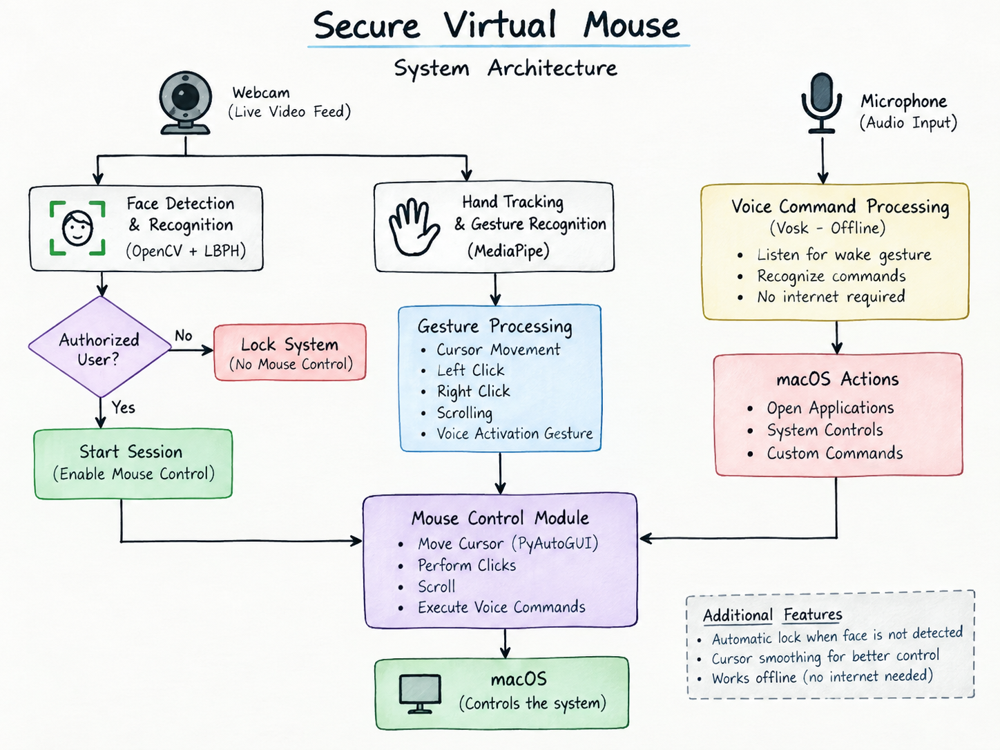

# Secure Virtual Mouse

A hands-free virtual mouse system built with Python that combines face authentication, hand gestures, and offline voice commands to control a macOS computer.

The project uses a webcam for face authentication and hand tracking. After successful authentication, hand gestures can be used to move the cursor, click, and scroll. A gesture can also activate offline voice recognition for selected macOS actions.

- **Platform:** macOS
- **Language:** Python
- **Project Type:** Computer Vision + Speech Recognition + Human-Computer Interaction

## Demo

A demonstration video will be added here.

YouTube: Coming soon

## What This Project Does

I built this project by combining face recognition, hand tracking, and offline speech recognition into one system instead of treating them as separate features.

The basic idea is:

Authenticate the user → enable the virtual mouse → control the computer using hand gestures and voice commands.

The system has three main parts:

- Face Authentication – uses OpenCV and LBPH to authenticate the user before enabling mouse control.
- Hand Gesture Control – uses MediaPipe to track the hand and detect gestures for cursor movement, clicking, scrolling, and voice activation.
- Offline Voice Commands – uses Vosk to recognize a limited set of voice commands locally without requiring an internet connection.

The system also has a session timeout that locks the virtual mouse when a face is no longer detected for the configured period.

## Main Features

### Face Authentication

- Uses OpenCV Haar Cascade for face detection.
- Uses LBPH (Local Binary Patterns Histograms) for face recognition.
- Requires consecutive successful recognition frames before granting access.
- Mouse gestures remain disabled while the session is locked.
- The cursor is restricted to the center of the screen while the system is locked.
- A session timeout automatically locks the system when the face is no longer detected for the configured period.

Current configuration:

- Session timeout: 20 seconds
- LBPH confidence threshold: 70
- Required successful frames: 2

### Hand Gesture Mouse Control

Hand tracking is performed using MediaPipe.

Current controls:

| Gesture | Action |
|---|---|
| Index finger movement | Move cursor |
| Thumb + Index | Left click |
| Thumb + Ring | Scroll up |
| Thumb + Pinky | Scroll down |
| Index + Ring | Right click |
| Index + Middle held together | Activate voice mode |

The cursor uses exponential smoothing to reduce unwanted movement.

Two cursor modes are available:

- SMOOTH – slower and more stable movement
- FAST – faster cursor movement

Keyboard controls:

- S → Smooth cursor mode
- F → Fast cursor mode
- Q → Quit the application

### Offline Voice Commands

Voice recognition is handled locally using Vosk.

The system does not need an internet connection for speech recognition.

Voice mode is activated by holding the Index + Middle finger gesture for the configured time.

The current implementation supports commands for actions such as:

- Open Camera
- Take a picture
- Close window
- Turn Wi-Fi on/off
- Minimize window
- Start voice typing / dictation
- Open Notes
- Lock the system

The recognized speech is matched against a limited command vocabulary before an action is performed.

Some commands use macOS-specific tools such as AppleScript, networksetup, and afplay, so this version is designed specifically for macOS.

## System Architecture

The webcam provides the video input used for face authentication and hand tracking.

After successful authentication, MediaPipe processes hand landmarks and the detected gestures are converted into mouse actions using PyAutoGUI.

The microphone is used when voice mode is activated. Vosk processes the recorded audio locally and the recognized command is passed to the corresponding macOS action.

## Project Screenshots

The following screenshots show the main features of the Secure Virtual Mouse system during execution.

### 1. Face Authentication

### 2. Cursor Movement Using Hand Gestures

### 3. Left Click Gesture Detection

### 4. Scroll Operation

### 5. System Locked State

## Technologies Used

| Technology | Purpose |
|---|---|
| Python | Main programming language |
| OpenCV | Face detection and image processing |
| LBPH | Face recognition |
| MediaPipe | Hand landmark detection and tracking |
| PyAutoGUI | Cursor, click and scroll control |
| Vosk | Offline speech recognition |
| SoundDevice | Audio recording |
| NumPy | Numerical processing |
| macOS / AppleScript | System-level actions |

## Project Structure

    Secure Virtual Mouse/
    │
    ├── src/
    │   ├── virtual_mouse.py
    │   ├── capture_faces.py
    │   └── train_lbph.py
    │
    ├── assets/
    │   ├── architecture/
    │   │   └── system-architecture.png
    │   └── screenshots/
    │
    ├── sounds/
    │   └── yes_sound.mp3
    │
    ├── requirements.txt
    ├── README.md
    ├── LICENSE
    └── .gitignore

The following files are intentionally kept local and are not uploaded to GitHub:

    faces/
    trainer/
    vosk-model-en-in-0.5/
    .vscode/

The faces/ directory contains the face images used for training. The trainer/ directory contains the trained LBPH model and labels.

The Vosk model is also kept outside the repository because of its size.

## Installation

### 1. Clone the repository

    git clone <YOUR-GITHUB-REPOSITORY-URL>
    cd Secure-Virtual-Mouse

### 2. Create a virtual environment

It is recommended to use a separate Python environment for this project.

    python3 -m venv venv
    source venv/bin/activate

### 3. Install the required packages

    pip install -r requirements.txt

### 4. Download the Vosk model

Download the required Vosk English-Indian speech recognition model and extract it into the project directory.

The expected folder name is:

    vosk-model-en-in-0.5

The project should contain:

    Secure Virtual Mouse/
    └── vosk-model-en-in-0.5/

### 5. Capture face images

Run:

    python src/capture_faces.py

Capture face images for the user who will be authenticated.

### 6. Train the LBPH recognizer

Run:

    python src/train_lbph.py

This creates the local LBPH face recognition model.

### 7. Run the virtual mouse

    python src/virtual_mouse.py

## macOS Permissions

Because this project accesses the camera, microphone, mouse, and some system functions, macOS may ask for additional permissions.

Check:

System Settings → Privacy & Security

Depending on your setup, you may need to allow:

- Camera
- Microphone
- Accessibility

If a system-level voice command does not work, check the relevant macOS permission first.

## Security Behavior

The virtual mouse is locked by default.

The basic authentication flow is:

Face detected → LBPH recognition → Authorized user → Session unlocked → Gesture control enabled

When the system is locked:

- Gesture-based mouse control is disabled.
- The cursor is restricted to the center of the screen.
- Face authentication is required to start a new session.

The system also keeps track of the last time a face was detected. If the timeout period is exceeded, the session is locked.

## Current Security Limitation

There is an important limitation in the current version.

After the initial LBPH authentication, the active-session presence check does not continuously verify that the detected face is the same person who originally authenticated the session.

Instead, the current implementation uses face detection and compares the detected face area with the area recorded during authentication.

Because of this, if the authorized user leaves while another person remains in front of the camera, the system may continue to consider the session active.

This is a known limitation of the current prototype.

A future version can improve this by periodically running LBPH verification during an active session.

## Known Limitations

This project is a working prototype and has some practical limitations:

- Cursor movement is not as responsive as a physical mouse.
- Cursor accuracy depends on camera position and hand visibility.
- Camera angle can affect hand gesture recognition.
- Poor lighting can affect face recognition and hand tracking.
- Large changes in face angle can affect LBPH recognition.
- Fingers being too close together can sometimes cause unintended gesture detection.
- The current session-presence mechanism does not continuously verify the identity of the detected face after initial authentication.
- Some voice commands are specific to macOS.
- The Vosk model must be downloaded separately.
- Voice recognition accuracy depends on microphone quality, background noise, and pronunciation.

## Future Improvements

Some improvements I would like to work on in future versions:

- Periodic authorized-face verification during an active session.
- Better face tracking between recognition checks.
- Improved gesture stability and accidental-click prevention.
- More responsive cursor movement.
- Better handling of different lighting conditions and face angles.
- More configurable gesture mappings.
- Additional voice commands.
- Improved voice recognition handling.
- Cross-platform support.
- A more polished graphical user interface.
- More reliable session security and user-presence detection.

## Why I Built This

I built this project to understand how computer vision, face recognition, speech recognition, and human-computer interaction can work together in a real-time application.

The project started with the idea of controlling a computer without physically touching a mouse.

While developing it, I also had to deal with practical problems such as:

- Real-time webcam processing
- Face recognition thresholds
- Camera positioning
- Hand tracking accuracy
- Cursor smoothing
- False gesture detection
- Offline speech recognition
- macOS permissions
- Session and authentication logic

These problems were useful because they showed me that making a computer-vision project work in a real environment is different from simply getting a model to work on sample data.

## Project Status

**Status: Working Prototype**

The main features are implemented:

- Face authentication
- Hand gesture mouse control
- Cursor movement
- Left and right clicking
- Scrolling
- Offline voice commands
- Voice activation gesture
- Session timeout
- Manual voice-based locking

The project is still being improved, especially around continuous authorized-user verification and more reliable real-world tracking.

## Author

**Umesh Kalbande**

Diploma in Artificial Intelligence & Machine Learning

## License

This project is licensed under the MIT License. See the LICENSE file for details.